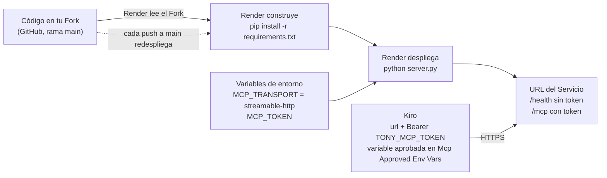

# Flujo para poner un servidor MCP en línea con Render y conectarlo a Kiro

## 1. Objetivo y requisitos previos

**Objetivo.** Al terminar esta guía habrás desplegado tu propio servidor MCP en Render y habrás conectado tu Kiro a él. Además, habrás comprobado que las respuestas de Kiro vienen de tu servicio en línea y no de los archivos de tu disco.

**Público.** Participantes del Enablement.

**Qué es un servidor MCP.** MCP (Model Context Protocol) es un protocolo que permite a Kiro llamar herramientas externas. Un servidor MCP es el programa que ofrece esas herramientas. En este repositorio, el servidor `tony-estandares` (`server.py`) expone tres herramientas de solo lectura sobre las reglas de la carpeta `reglas/`: `listar_reglas`, `obtener_regla` y `buscar_reglas`.

> **El ejercicio usa solo el modo remoto.** El servidor también puede correr en tu propio equipo (modo local), pero ese modo queda fuera del ejercicio. Sus instrucciones están en [instalacion-local.md](instalacion-local.md).

> **Cada Participante usa solo su propio Servicio y su propio Token.** Desplegarás tu propio Servicio en Render, con un Token generado por Render para ti. No uses el Servicio ni el Token de otra persona. Tampoco publiques tu Token en tu Fork, en el chat de Kiro ni en chats grupales.

### Requisitos previos

- Una cuenta de GitHub.
- Una cuenta de Render.
- Git instalado, porque el ejercicio usa `git clone` y `git pull`.
- Kiro instalado.

### Marcadores que verás en la guía

| Marcador | Qué debes poner |
|---|---|
| `<URL_DEL_SERVICIO>` | La URL de tu Servicio en Render, que Render te muestra al terminar el despliegue. |
| `<tu-usuario>` | Tu nombre de usuario de GitHub. |
| `<token>` | El valor de tu Token, que Render genera. Nunca lo escribas en un archivo del repositorio. |

## 2. El flujo

El diagrama muestra el recorrido completo, desde el código hasta Kiro.



Una frase por eslabón:

| Eslabón | Qué hace |
|---|---|
| Código en tu Fork | Render despliega lo que hay en la rama `main` de tu Fork, no lo que hay en tu disco. |
| Render construye | Render instala las dependencias de `requirements.txt` en cada despliegue. |
| Render despliega | Render arranca `python server.py` y le pasa el puerto en la variable `PORT`. |
| Variables de entorno | `MCP_TRANSPORT=streamable-http` activa el modo HTTP y `MCP_TOKEN` es la clave que exige `/mcp`. |
| URL del Servicio | `/health` responde sin token para el chequeo de Render y `/mcp` atiende a Kiro solo con token. |
| Kiro | Kiro llama a `/mcp` con la cabecera `Authorization: Bearer` y el valor de `TONY_MCP_TOKEN`, que solo sustituye si la variable está aprobada. |
| Cada push redespliega | Con Auto-Deploy On Commit, cada push a `main` vuelve a construir y desplegar el Servicio. |

### Términos que usa la guía

- **Fork:** copia de un repositorio de GitHub en tu propia cuenta. Tu Servicio se despliega desde tu Fork, y los cambios que hagas en él no afectan al repositorio original.
- **Web Service:** tipo de servicio de Render que ejecuta un programa y lo deja accesible por una URL de internet. Tu Servicio es un Web Service.
- **Variable de entorno:** valor con nombre que el sistema entrega a un programa al arrancarlo, fuera del código. Así el Token no se guarda en el repositorio.
- **Endpoint:** dirección de un servicio que responde a un tipo de petición. Este servidor tiene dos: `/health` y `/mcp`.
- **Token bearer:** clave secreta que el cliente envía en la cabecera `Authorization: Bearer <token>` para que el servidor acepte la petición. Aquí es `MCP_TOKEN` en Render y `TONY_MCP_TOKEN` en tu equipo.
- **Health check:** comprobación que Render repite sobre una dirección del Servicio (`/health`) para saber si está vivo. Si falla, Render da el despliegue por fallido.
- **Redespliegue:** nuevo ciclo de construir y arrancar el Servicio con el código más reciente de `main`. Render lo hace solo con cada push.
- **Steering:** archivo de instrucciones que Kiro carga en cada conversación del repositorio. En este repositorio, `.kiro/steering/guia-enablement.md` hace que Kiro te guíe paso a paso.

## 3. Parte a: tu Fork y tu Servicio

En esta parte haces un Fork del Repositorio, lo clonas y despliegas tu propio Servicio en Render. El Servicio usa un Token que Render genera para ti. Ese Token solo vive en Render y, más adelante, en tu variable de entorno `TONY_MCP_TOKEN`. No lo publiques en tu Fork, en el chat de Kiro ni en chats grupales.

Cada paso termina con su **Resultado esperado**. Confirma ese resultado antes de pasar al siguiente paso.

1. **Haz un Fork del Repositorio** `IsaacMendoza-dv/MCP-Tony` en tu cuenta de GitHub, con el botón **Fork** de la página del repositorio.

   **Resultado esperado:** GitHub te lleva a `https://github.com/<tu-usuario>/MCP-Tony`, tu copia del repositorio.

2. **Clona tu Fork** en tu equipo. Reemplaza `<tu-usuario>` por tu nombre de usuario de GitHub.

   ```powershell
   git clone https://github.com/<tu-usuario>/MCP-Tony.git
   ```

   **Resultado esperado:** aparece la carpeta `MCP-Tony` con `server.py`, `requirements.txt` y la carpeta `reglas/`.

3. **Abre la carpeta `MCP-Tony` en Kiro** (menú **File > Open Folder**).

   **Resultado esperado:** el chat de Kiro responde en español y en modo guía, porque carga el steering `.kiro/steering/guia-enablement.md` del Fork.

4. **Crea un Web Service en Render y autoriza el acceso a GitHub.** En el panel de Render elige **New > Web Service**. La primera vez, Render te pide autorizar su acceso a GitHub para poder ver tu Fork. Autorízalo.

   **Resultado esperado:** Render lista tus repositorios de GitHub, entre ellos tu Fork `MCP-Tony`.

5. **Elige tu Fork y llena la configuración** con estos valores:

   | Campo | Valor |
   |---|---|
   | Repositorio | Tu Fork `MCP-Tony` |
   | Language | Python 3 |
   | Branch | `main` |
   | Root Directory | Vacío |
   | Build Command | `pip install -r requirements.txt` |
   | Start Command | `python server.py` |
   | Instance Type | Free |

   **Resultado esperado:** el formulario muestra los valores de la tabla.

6. **Agrega las variables de entorno.** Una variable de entorno es un valor con nombre que Render entrega al programa al arrancarlo, fuera del código.

   | Variable | Valor |
   |---|---|
   | `MCP_TRANSPORT` | `streamable-http` |
   | `MCP_TOKEN` | Pulsa el botón **Generate** para que Render genere el valor |

   No definas la variable `PORT`: Render la asigna solo. Guarda el valor de `MCP_TOKEN` en un lugar seguro, porque lo necesitarás en la parte b. Es tu Token, generado para tu Servicio, y no debes usar el de otra persona.

   **Resultado esperado:** el formulario muestra las dos variables, `MCP_TRANSPORT` y `MCP_TOKEN`, y no muestra `PORT`.

7. **Configura el Health Check Path y el Auto-Deploy.** En **Advanced**, escribe `/health` en **Health Check Path**.

   > **Cuidado con `/healthz`.** El formulario de Render sugiere `/healthz`. Cámbialo a `/health`. La ruta `/healthz` responde 401, porque solo `/health` está exenta del token. Con un 401, Render da el despliegue por fallido aunque el servidor haya arrancado.

   Deja **Auto-Deploy** en **On Commit**. Así, cada push a la rama `main` de tu Fork redespliega tu Servicio.

   **Resultado esperado:** **Health Check Path** dice `/health` y **Auto-Deploy** dice **On Commit**.

8. **Despliega.** Pulsa **Deploy web service**.

   **Resultado esperado:** el panel de Render muestra el despliegue como terminado y la URL de tu Servicio. En el resto de la guía, esa URL es `<URL_DEL_SERVICIO>`.

9. **Comprueba que el Servicio está en línea.** Reemplaza `<URL_DEL_SERVICIO>` por la URL de tu Servicio.

   ```powershell
   Invoke-RestMethod <URL_DEL_SERVICIO>/health
   ```

   **Resultado esperado:** PowerShell imprime una tabla con el encabezado `estado` y el valor `ok` debajo. No imprime un JSON.

   ```
   estado
   ------
   ok
   ```

10. **Comprueba que `/mcp` exige el token.** Esta llamada no envía token.

    ```powershell
    curl.exe -s -o NUL -w "%{http_code}" <URL_DEL_SERVICIO>/mcp
    ```

    Escribe `curl.exe` y no `curl`. En Windows PowerShell, `curl` es un alias de `Invoke-WebRequest`, que lanza un error en lugar de mostrar el código de estado.

    **Resultado esperado:** el comando imprime `401`.

> **El plan Free se duerme.** Si nadie llama a tu Servicio durante un rato, Render lo duerme. La primera llamada después de eso tarda alrededor de un minuto. Las llamadas siguientes son rápidas.

## 4. Parte b: conecta tu Kiro

En esta parte configuras tu Kiro para que llame a tu Servicio en Render. Necesitas tu Token (el valor de `MCP_TOKEN` que guardaste en la parte a) y la URL de tu Servicio (`<URL_DEL_SERVICIO>`).

Cada paso termina con su **Resultado esperado**. Confirma ese resultado antes de pasar al siguiente paso.

1. **Define la variable de entorno `TONY_MCP_TOKEN`.** Es la copia de tu Token en tu equipo. Reemplaza `<token>` por el valor de tu `MCP_TOKEN` y ejecuta el comando en tu propia terminal. No lo escribas en un archivo del repositorio ni en el chat de Kiro.

   ```powershell
   [Environment]::SetEnvironmentVariable("TONY_MCP_TOKEN", "<token>", "User")
   ```

   **Resultado esperado:** el comando termina sin mostrar errores. La variable queda definida para los programas que abras después, así que Kiro la verá cuando lo reinicies en el paso 5.

2. **Aprueba la variable en Kiro.** Busca 'Mcp Approved Env Vars' en la configuración de Kiro (Ctrl+,) y agrega `TONY_MCP_TOKEN` a la lista.

   Sin esa aprobación, Kiro no sustituye `${TONY_MCP_TOKEN}` en el `mcp.json`. Entonces envía la cabecera sin el valor del Token y el Servicio responde 401.

   **Resultado esperado:** `TONY_MCP_TOKEN` aparece en la lista de Mcp Approved Env Vars.

3. **Agrega la entrada `tony-estandares-remoto` en `~/.kiro/settings/mcp.json`.** Ese es el archivo de nivel usuario, y es el único lugar donde debes ponerla. No la pongas en `.kiro/settings/mcp.json` dentro de tu Fork, porque la URL de tu Servicio se subiría al repositorio con tu siguiente push.

   En Windows, el archivo es `C:\Users\<tu-usuario-de-windows>\.kiro\settings\mcp.json`. Si no existe, créalo con el bloque completo.

   Pide a tu Kiro el bloque y pégalo tú en el archivo. Kiro no puede escribir en `~/.kiro/settings/`. Reemplaza `<URL_DEL_SERVICIO>` por la URL de tu Servicio. Si el archivo ya tiene otras entradas en `mcpServers`, agrega esta junto a ellas.

   ```json
   {
     "mcpServers": {
       "tony-estandares-remoto": {
         "url": "<URL_DEL_SERVICIO>/mcp",
         "headers": { "Authorization": "Bearer ${TONY_MCP_TOKEN}" },
         "autoApprove": ["listar_reglas", "obtener_regla", "buscar_reglas"]
       }
     }
   }
   ```

   Si ya tienes la entrada local `tony-estandares`, desactívala mientras haces el ejercicio. Agrega `"disabled": true` dentro de esa entrada:

   ```json
   "tony-estandares": {
     "disabled": true
   }
   ```

   Deja el resto de los campos de esa entrada como estaban.

   **Resultado esperado:** `~/.kiro/settings/mcp.json` contiene `tony-estandares-remoto` con la URL de tu Servicio terminada en `/mcp` y, si la tenías, `tony-estandares` con `"disabled": true`. El archivo del Fork no cambió.

4. **Despierta el Servicio antes de reiniciar Kiro.** Si el plan Free dejó dormido tu Servicio, Kiro puede fallar al conectar. Reemplaza `<URL_DEL_SERVICIO>` por la URL de tu Servicio.

   ```powershell
   Invoke-RestMethod <URL_DEL_SERVICIO>/health
   ```

   **Resultado esperado:** PowerShell imprime la tabla con el encabezado `estado` y el valor `ok` debajo. Si el Servicio estaba dormido, la respuesta puede tardar alrededor de un minuto.

   ```
   estado
   ------
   ok
   ```

5. **Reinicia Kiro.** Ciérralo por completo y ábrelo de nuevo, para que lea la variable `TONY_MCP_TOKEN` y el `mcp.json`.

   **Resultado esperado:** Kiro abre de nuevo y empieza a conectar con `tony-estandares-remoto`.

6. **Comprueba la conexión en el panel de MCP.** Abre el panel de MCP de Kiro y busca `tony-estandares-remoto`.

   **Resultado esperado:** el panel muestra `tony-estandares-remoto` conectado, con tres herramientas: `listar_reglas`, `obtener_regla` y `buscar_reglas`.

## 5. Parte c: prueba final

**Por qué existe esta prueba.** Dentro de tu Fork, Kiro puede leer la carpeta `reglas/` directamente del disco. Por eso una respuesta correcta no demuestra que venga de tu Servicio en Render. Esta prueba cambia una regla solo en GitHub, sin tocar tu clon local. Si Kiro devuelve el cambio, la respuesta solo pudo venir de tu Servicio.

Cada paso termina con su **Resultado esperado**. Confirma ese resultado antes de pasar al siguiente paso.

1. **Edita una regla en la web de GitHub.** Abre tu Fork en GitHub, entra a un archivo de la carpeta `reglas/`, edítalo y guarda el cambio (commit) en la rama `main`. No hagas `git pull` en tu clon local: el clon debe quedar sin el cambio.

   Si en lugar de editar una regla creas una regla nueva, escribe el nombre del archivo con guiones y sin espacios, por ejemplo `mi-regla-nueva.md`. La herramienta `listar_reglas` omite los nombres no válidos.

   **Resultado esperado:** GitHub muestra tu cambio guardado en `main`, y el archivo de tu clon local sigue sin ese cambio.

2. **Espera a que Render termine el redespliegue.** Con Auto-Deploy On Commit, tu cambio inicia un despliegue nuevo en Render. El redespliegue terminó cuando el panel de Render muestra ese despliegue como terminado.

   **Resultado esperado:** el panel de Render muestra el despliegue nuevo como terminado.

3. **Pide la regla a Kiro con el nombre exacto de la entrada remota.** Escribe en el chat de Kiro:

   ```
   usa tony-estandares-remoto para obtener la regla <nombre-de-la-regla>
   ```

   Reemplaza `<nombre-de-la-regla>` por el nombre de la regla que editaste, sin `.md`. Por ejemplo, si editaste `nombres-de-variables.md`, escribe `nombres-de-variables`.

   **Resultado esperado:** Kiro empieza a llamar a la herramienta de `tony-estandares-remoto`.

4. **Comprueba la respuesta.** Revisa el chat de Kiro.

   **Resultado esperado:** el chat muestra la llamada a la herramienta `obtener_regla` de `tony-estandares-remoto`, y la respuesta trae el cambio que tu clon local todavía no tiene. Eso prueba que el flujo en línea funciona.

5. **Sincroniza tu clon local.** Ahora sí trae el cambio a tu equipo:

   ```powershell
   git pull
   ```

   **Resultado esperado:** Git descarga el cambio y el archivo de tu clon local queda igual que el de tu Fork.

## 6. Si tu token se expone

Si pegaste tu Token en el chat de Kiro, en tu Fork, en un chat grupal o en cualquier otro lugar público, considéralo comprometido. Cambia el Token así:

1. **Genera un `MCP_TOKEN` nuevo en Render.** Abre tu Servicio, entra a **Environment**, edita `MCP_TOKEN`, pulsa **Generate** para que Render cree un valor nuevo y guarda los cambios. Render redespliega el Servicio con el Token nuevo, y el anterior deja de funcionar.

   **Resultado esperado:** el panel de Render muestra el despliegue nuevo como terminado.

2. **Actualiza `TONY_MCP_TOKEN` en tu equipo.** Reemplaza `<token>` por el valor nuevo de `MCP_TOKEN` y ejecuta el comando en tu propia terminal. No lo escribas en un archivo del repositorio ni en el chat de Kiro.

   ```powershell
   [Environment]::SetEnvironmentVariable("TONY_MCP_TOKEN", "<token>", "User")
   ```

   **Resultado esperado:** el comando termina sin mostrar errores.

3. **Reinicia Kiro por completo**, para que lea el valor nuevo de `TONY_MCP_TOKEN`.

   **Resultado esperado:** el panel de MCP muestra `tony-estandares-remoto` conectado, con tres herramientas.

## 7. Problemas frecuentes

| Síntoma | Causa y solución |
|---|---|
| El servidor remoto responde 401 | 1) `TONY_MCP_TOKEN` no está aprobada en Mcp Approved Env Vars, y Kiro no sustituye `${TONY_MCP_TOKEN}`. Agrégala a esa lista. 2) `TONY_MCP_TOKEN` no coincide con `MCP_TOKEN` de Render. Vuelve a definirla con el valor de Render. 3) Kiro no se reinició tras definir la variable. Ciérralo por completo y ábrelo de nuevo. |
| La primera llamada tarda alrededor de un minuto | El plan Free de Render estaba dormido. Las llamadas siguientes son rápidas. |
| Render marca el despliegue como fallido aunque el log muestra que el servidor arrancó | El Health Check Path quedó en `/healthz`, que responde 401. Cámbialo a `/health`. |
| `curl` muestra un error en lugar del código | En Windows PowerShell `curl` es un alias de `Invoke-WebRequest`. Usa `curl.exe`. |
| Kiro responde la regla sin cambios en la parte c | Render no terminó de redesplegar, o Kiro leyó el disco. Espera el despliegue terminado y pide la regla con "usa tony-estandares-remoto para obtener la regla <nombre-de-la-regla>". |
| El panel de MCP muestra error al abrir Kiro | El Servicio estaba dormido. Despiértalo con `Invoke-RestMethod <URL_DEL_SERVICIO>/health` y reconecta `tony-estandares-remoto` desde el panel. |

## 8. Lista de comprobación

Marca cada casilla cuando tengas el resultado esperado.

**Parte a: tu Fork y tu Servicio**

- [ ] GitHub te lleva a `https://github.com/<tu-usuario>/MCP-Tony`, tu copia del repositorio.
- [ ] Aparece la carpeta `MCP-Tony` con `server.py`, `requirements.txt` y la carpeta `reglas/`.
- [ ] El chat de Kiro responde en español y en modo guía.
- [ ] Render lista tus repositorios de GitHub, entre ellos tu Fork `MCP-Tony`.
- [ ] El formulario muestra los valores de la tabla de configuración.
- [ ] El formulario muestra las variables `MCP_TRANSPORT` y `MCP_TOKEN`, y no muestra `PORT`.
- [ ] **Health Check Path** dice `/health` y **Auto-Deploy** dice **On Commit**.
- [ ] El panel de Render muestra el despliegue como terminado y la URL de tu Servicio.
- [ ] `Invoke-RestMethod <URL_DEL_SERVICIO>/health` imprime la tabla `estado` / `ok`.
- [ ] `curl.exe -s -o NUL -w "%{http_code}" <URL_DEL_SERVICIO>/mcp` imprime `401`.

**Parte b: conecta tu Kiro**

- [ ] El comando que define `TONY_MCP_TOKEN` termina sin mostrar errores.
- [ ] `TONY_MCP_TOKEN` aparece en la lista de Mcp Approved Env Vars.
- [ ] `~/.kiro/settings/mcp.json` contiene `tony-estandares-remoto` con la URL de tu Servicio terminada en `/mcp`, y el archivo del Fork no cambió.
- [ ] `Invoke-RestMethod <URL_DEL_SERVICIO>/health` imprime la tabla `estado` / `ok` antes de reiniciar Kiro.
- [ ] Kiro abre de nuevo y empieza a conectar con `tony-estandares-remoto`.
- [ ] El panel de MCP muestra `tony-estandares-remoto` conectado, con `listar_reglas`, `obtener_regla` y `buscar_reglas`.

**Parte c: prueba final**

- [ ] GitHub muestra tu cambio guardado en `main`, y el archivo de tu clon local sigue sin ese cambio.
- [ ] El panel de Render muestra el despliegue nuevo como terminado.
- [ ] Kiro empieza a llamar a la herramienta de `tony-estandares-remoto`.
- [ ] El chat muestra la llamada a `obtener_regla` de `tony-estandares-remoto`, y la respuesta trae el cambio que tu clon local todavía no tiene.
- [ ] `git pull` descarga el cambio y el archivo de tu clon local queda igual que el de tu Fork.
